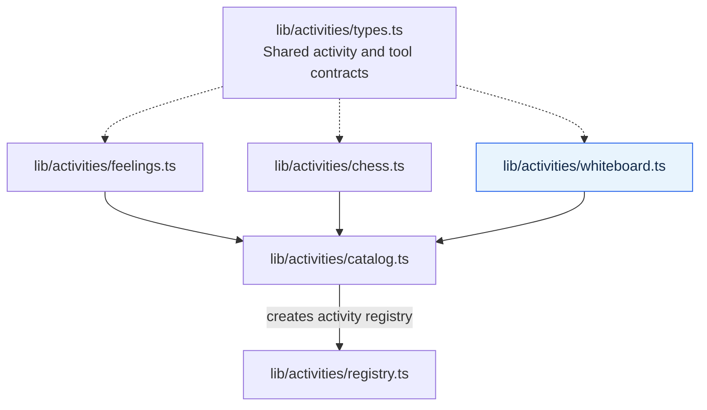
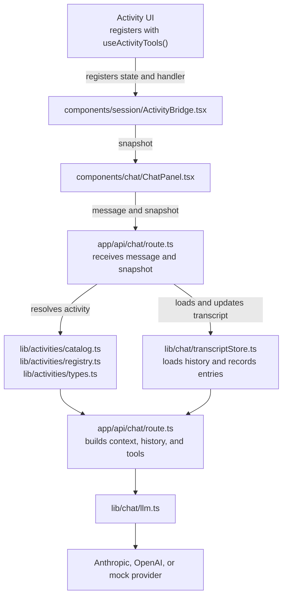
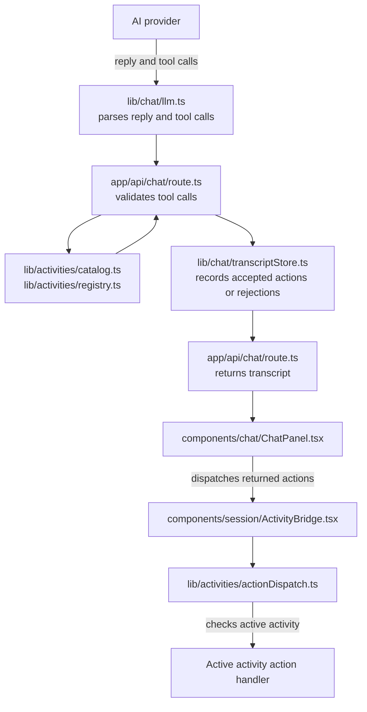

**Author:**  JP Lacsamana
**Date:**  
**Status:** Draft

## 1. Summary

This feature is for enabling the ai client to draw on the excalidraw whiteboard tool. The learner should see the drawing appear. TODO: [Methodology statement]


- *What should the AI client be able to do?*
- *What should the learner see while it does it?*
- *What browser or whiteboard is it allowed to control?*

## 2. Problem and Goals

### Problem

*What currently happens, and what is missing?*

The ai client has no way to interact with the whiteboard and draw somewhat coherent doodles based on the chat conversation with learner and the client.

### Goals

- The ai client can draw on the white board
- The ai client gives doodles that relate to the conversation
- The learner can understand what the ai client is drawing

### Non-goals

- TODO

## TEMP Implementation Brainstorm

## 3. User Scenarios

Describe the main flow from the learner’s perspective.

1. The learner: tells the client to draw a doodle describing a situation, feeling, event, or other mental health related issue
2. The AI client: draws the doodle on the white board and will reply to the learner with a short description
3. The whiteboard: shows the doodle drawn by the ai client
4. The learner can stop, interrupt, or undo by: erasing the drawing.
5. If the learner leaves the whiteboard while the AI is drawing, attempt to stop with an are you sure message and then stop drawing if necessary.

Include what should happen if the learner leaves the whiteboard while the AI is drawing.

## 4. Define "Drawing" TODO

**Proposal 1: mouse-use via computer interaction (either through browser or other)**
- Browser Use with OpenAI API: https://github.com/browser-use/browser-use
- Anthropic Computer Use API: https://platform.claude.com/docs/en/agents-and-tools/tool-use/computer-use-tool
- PROS
	- allows the LLM to handle tools and other toys on the site more generally
- CONS: 
	- over-engineering for just having the llm make a drawing affect on the white board
	- it's complicated to have an llm interact with the browser page at the same time a user is using that same page (*i don't know how complicated though)

**Proposal 2: client provides validated drawing with coordinates and strokes
- give example doodles for the llm to reference
- PROS:
	- Actually using excalidraw and providing strokes, points, etc... on the whiteboard
- CONS:
	- hard for the llm to draw coherent pictures this way (I tried it)

**Proposal 3: have the ai create raw images itself (not excalidraw), app will render image into the whiteboard** (CHOSEN)
- Vector images like an svg
- make them the background if possible on excalidraw and then you can still draw on top
- then ai can clear it every drawing.
- PROS:
	- can style it to look like a doodle
	- super easy to get an llm to do
	- can animate to look like its being drawn
- CONS:
	- it's just an image inserted into excaladraw not an actual "drawing"

## 5. Proposed Architecture

The below shows the current architecture components in purple, and the additions in blue (only whiteboard.ts indicated). View this as the big picture, but the real changes will happen in `whitboard.ts`, `llm.ts` (parsing the drawing), and the active activity handler for the whiteboard to be implemented.

### 1. Activity tool registration





### 2. Shared activity-tool request flow



### 3. Shared activity-tool response flow



### 4. Whiteboard action handler
```mermaid

```


| Component | Runs where? | Responsibility |
|---|---|---|
| AI model |  |  |
| Browser-control agent or library |  |  |
| Local helper / extension, if needed |  |  |
| Telehealth app |  |  |
| Whiteboard |  |  |

*Draw the data flow:*

```text
Learner invitation
    → [capture canvas]
    → [send observation to model]
    → [receive mouse action]
    → [apply action in browser]
    → [capture updated canvas]
    → [continue or finish]
````


## 6. Implementation Plan
TODO: Steps to implement
- TODO: how activity is resolved in route.ts for whiteboard specifically
- TODO: Does transcriptStore need to be updated?
- TODO: Does LLM.ts need a new prompt?
- TODO: Does llm.ts need new code to parse svg returned from llm?
- Add new activity validation in lib/actvities for the whiteboard
- TODO: how should the action handler handle actionDispatch's request for the whiteboard rendering?

### Resolving the activity in route.ts

