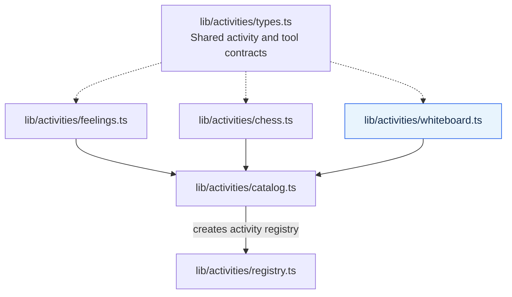
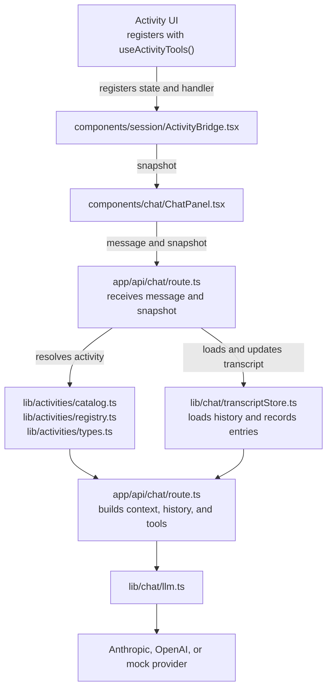
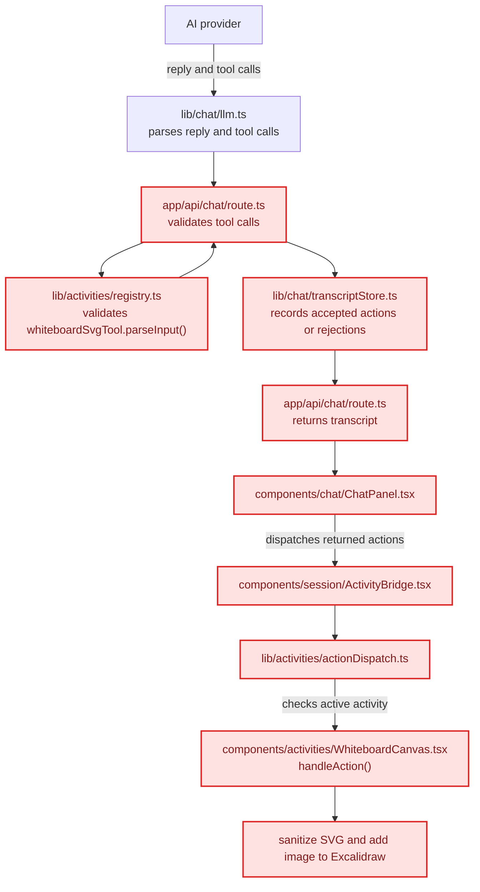
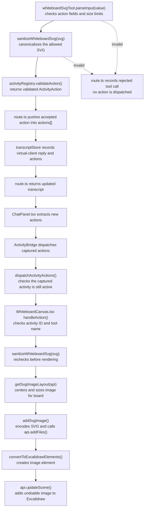

**Author:**  JP Lacsamana
**Date:**  
**Status:** Draft

## 1. Summary

This feature is for enabling the ai client to draw on the excalidraw whiteboard tool. The learner should see the drawing appear. We're doing this via svg rendering, prompt-engineering to keep svg doodle style, and animation (last thing implemented) to imitate drawing.

## 2. Problem and Goals

### Problem

The ai client has no way to interact with the whiteboard and draw somewhat coherent doodles based on the chat conversation with learner and the client.

### Goals

- The ai client can draw on the white board
- The ai client gives doodles that relate to the conversation
- The learner can understand what the ai client is drawing

### Non-goals

- Generate in-depth svg's that look realistic or unlike a the doodle of a child
- take control of the browser or user's computer

## 3. User Scenarios

Describe the main flow from the learner’s perspective.

1. The learner: tells the client to draw a doodle describing a situation, feeling, event, or other mental health related issue
2. The AI client: draws the doodle on the white board and will reply to the learner with a short description
3. The whiteboard: shows the doodle drawn by the ai client
4. The learner can stop, interrupt, or undo by: erasing the drawing.
5. If the learner leaves the whiteboard while the AI is drawing, attempt to stop with an are you sure message and then stop drawing if necessary.

Include what should happen if the learner leaves the whiteboard while the AI is drawing.

## 4. Define "Drawing"

**Proposal 1: mouse-use via computer interaction (either through browser or other)**
- Browser Use with OpenAI API: https://github.com/browser-use/browser-use
- Anthropic Computer Use API: https://platform.claude.com/docs/en/agents-and-tools/tool-use/computer-use-tool
- PROS
	- allows the LLM to handle tools and other toys on the site more generally
- CONS: 
	- over-engineering for just having the llm make a drawing affect on the white board
	- it's complicated to have an llm interact with the browser page at the same time a user is using that same page (*i don't know how complicated though)

**Proposal 2: client provides validated drawing with coordinates and strokes
- give example doodles for the llm to reference
- PROS:
	- Actually using excalidraw and providing strokes, points, etc... on the whiteboard
- CONS:
	- hard for the llm to draw coherent pictures this way (I tried it)

**(SELECTED) Proposal 3: have the ai create raw images itself (not excalidraw), app will render image into the whiteboard**
- Vector images like an svg
- make them the background if possible on excalidraw and then you can still draw on top
- then ai can clear it every drawing.
- PROS:
	- can style it to look like a doodle
	- super easy to get an llm to do
	- can animate to look like its being drawn
- CONS:
	- it's just an image inserted into excaladraw not an actual "drawing"

## 5. Proposed Architecture

The below shows the current architecture components in purple, and the additions in blue (only whiteboard.ts indicated). View this as the big picture, but the real changes will happen in `whitboard.ts`, `llm.ts` (parsing the drawing), and the active activity handler for the whiteboard to be implemented.

### 1. Activity tool registration





### 2. Shared activity-tool request flow



### 3. Shared activity-tool response flow

Red nodes mark the shared response path when the active activity is the whiteboard; the final node shows its SVG rendering step. RED = Whiteboard specifc



### 4. More Detailed Whiteboarding flow.

This diagram starts when the returned whiteboard tool input reaches `whiteboardSvgTool.parseInput()` and follows the accepted or rejected action through browser dispatch and Excalidraw rendering.



| Component | Runs where? | Responsibility |
|---|---|---|
| AI model |  |  |
| Browser-control agent or library |  |  |
| Local helper / extension, if needed |  |  |
| Telehealth app |  |  |
| Whiteboard |  |  |

*Draw the data flow:*

```text
Learner invitation
    → [capture canvas]
    → [send observation to model]
    → [receive mouse action]
    → [apply action in browser]
    → [capture updated canvas]
    → [continue or finish]
````


## 6. Implementation Plan
TODO: Steps to implement
- TODO: how activity is resolved in route.ts for whiteboard specifically (DONE see Resolving tyhe activity in route.ts section)
- TODO: Does transcriptStore need to be updated? (DONE: no it doesn't, but size limit and svg sanitization needed)
- TODO: Does LLM.ts need a new prompt? (DONE: needs an activty description)
- TODO: Does llm.ts need new code to parse svg returned from llm? (DONE: no this is done in whiteboard.tsx)
- Add new activity validation in lib/actvities for the whiteboard (DONE)
- TODO: how should the action handler handle actionDispatch's request for the whiteboard rendering? (DONE: it's already generalized, action given to whiteboard.tsx and the whiteboard component is in charge of rendering the svg)

### 6.1 Resolving the activity in route.ts

**`components/activities/WhiteboardCanvas.tsx` — after the whiteboard state and handler are defined** **(Line 291)**

This registers the whiteboard snapshot and action handler so chat requests can include the active activity.

```typescript
useActivityTools("whiteboard", state, handleAction);
```

**`lib/activities/catalog.ts` — import near line 4; add to registry array near lines 7–12**

This registers the definition so the registry can find the `"whiteboard"` activity ID.

```typescript
import { whiteboardActivity } from "./whiteboard";

export const activityRegistry = createActivityRegistry([
  feelingsActivity,
  chessActivity,
  whiteboardActivity,
]);
```

**`app/api/chat/route.ts - lines 94 - 98; no change**'

Resolves any registered activity and validates its snapshot
```typescript
if (opeation.activity !== undefined)
	activeActivity = activityRegistry.resolve(operation.activity)
```

###  6.2 Whiteboard.ts

**6.2.1. Imports and data types**
define the validated state and the shape of the tool inputs

```typescript
import {
  MAX_WHITEBOARD_SPOKEN_TEXT_LENGTH,
  MAX_WHITEBOARD_SVG_LENGTH,
  sanitizeWhiteboardSvg,
} from "@/lib/whiteboard/svg"; // TODO: Need to make svg component
import { WHITEBOARD_DOODLE_COLORS } from "@/lib/whiteboard/svg";
import {
  defineActivity,
  type ActivityDefinition,
  type ActivityTool,
} from "./types";

interface WhiteboardState {
	hasContent: boolean
}

interface WhiteboardSvgAction {
	svg: string;
	spokenText: string;
}

```

**6.2.2. Validate the activity state**
checks for valid activity snapshot, (info telling the app whether the whiteboard is open or not).

```typescript
function parseWhiteboardState(value: unknown): WhiteboardState {
  if (!isRecord(value) || typeof value.hasContent !== "boolean")
    throw new Error("Expected a whiteboard state with a content flag.");

  if (Object.keys(value).some((key) => key !== "hasContent"))
    throw new Error("Whiteboard state contains an unsupported field.");

  return { hasContent: value.hasContent };
}
```

**6.2.3. Give the model drawing guidance**
The prompt for the LLM to adapt the doodle style when it creates the svg
```typescript
const palette = WHITEBOARD_DOODLE_COLORS
  .map(({ value }) => value)
  .join(", ");

const drawingGuidance = [
  "Create one small, friendly SVG doodle for an educational telehealth whiteboard tool",
  "Make it redimentary, like a quick sketch someone could draw by hand in a few seconds.", 
  "Use about 3 - 5 simple shapes or strokes, loose slightly, imperfect lines, and minimal detail.",
  "Make it recognizable without making it polished or realistic; avoid shading, textures, tiny details, and decorative backgrounds",
  "Use a 500 by 350 viewBox and keep the drawing inside it.".
  "Use only g, path, rect, circle, ellipse, line, polyline, and polygon elements.",
  "Do not FILL any of the shapes with color, the svg should only contain outlines and you can use the colors otherwise for the strokes",
  "do not use text, scripts, stylesheets, filters, gradients, masks, clip paths, images, links, animation, or external resources.",
  `Use colors from this ${pallete}.`
].join(" ");
```

**6.2.4. Validate and sanitize the returned action**
The activity parse checks the action shape and spoken line and the sanitizer canonicalizes the SVG before it is recorded or rendered.

`createActivityRegistry()` registers the whiteboard definition; it does not build the prompt. The route resolves the active snapshot, then uses the resolved activity description to build `activityContext`. The activity tool schema is passed to `generateClientReply()` separately from `systemPrompt`.

```typescript
function parseWhiteboardSvgAction(value: unknown): WhiteboardSvgAction {
  if (!isRecord(value))
    throw new Error("Expected a whiteboard SVG action.");

  if (Object.keys(value).some((key) => !["svg", "spokenText"].includes(key)))
    throw new Error("Whiteboard SVG action contains an unsupported field.");

  if (typeof value.svg !== "string" || !value.svg.trim())
    throw new Error("The drawing must include an SVG document.");

  if (value.svg.length > MAX_WHITEBOARD_SVG_LENGTH)
    throw new Error("The generated SVG is too large. Try a simpler doodle.");

  if (
    typeof value.spokenText !== "string" ||
    !value.spokenText.trim() ||
    value.spokenText.trim().length > MAX_WHITEBOARD_SPOKEN_TEXT_LENGTH
  )
    throw new Error("The client drawing needs a short spoken description.");

  return {
  // TODO: implement sanitizeWhiteboardSvg()
    svg: sanitizeWhiteboardSvg(value.svg),
    spokenText: value.spokenText.trim(),
  };
}
```

**6.2.5. Define the model tool**
The tool asks for structured SVG plus a short line the client can say. The line is not a part of the SVG.
```typescript
const whiteboardSvgTool: ActivityTool<WhiteboardSvgAction> = {
	name: "replace_whiteboard_with_svg",
	description: [
		"Use only after the learner directly asks you or clearly agrees to a drawing.",
		"Draw one relevant feeling, event, idea already discussed, or what the learner prompted you to draw",
		drawingGuidance,
		"Put the complete SVG document in the svg field, with no Markdown fences or explanation in that field.",
		"This action replaces the entire whiteboard",
	].join(" "),
	inputSchema: {
		type: "object",
		properties: {
			svg: {
				type: "string",
				description: "One complete, static SVG doodle document.",
				minLength: 1,
				maxLength: MAX_WHITEBOARD_SVG_LENGTH,
			},
			spokenText: {
				type: "string",
				description: "A short first-person line the client can say about the doodle.",
				minLength: 1,
				maxLength: MAX_WHITEBOARD_SPOKEN_TEXT_LENGTH,
			},
		},
		required: ["svg", "spokenText"],
		additionalProperties: false,
	},
	parseInput: parseWhiteboardSvgAction,
};
```

**6.2.6. Define the model tool**
This combines the state description and tool into the activity definition.
```typescript
const definition: ActivityDefinition<WhiteboardState> = {
	id: "whiteboard",
	label: "whiteboard",
	parseState: parseWhiteboardState,
	describeState: ({ hasContent }) =>
		[
			"The learner is using a shared whiteboard as part of this conversation.",
			`The board ${hasContent ? "alread has content" : "is blank" }.`,
			"Draw only after the learner directly asks you or clearly agrees to a drawing",
			drawingGuidance,
			"The drawing replaces the whole board, including the learner's existing marks.",
		].join(""),
	tools: [whiteboardSvgTool],
};

export const whiteboardActivity = defineActivity(definition);

function isRecord(value: unknown): value is Record<string, unkown> {
return typeof value === "object" && value !== null && !Array.isArray(value);}
```


### 6.3 sanitizeSvg.ts

Keeps the SVG validation separate from the activity definition. Accepts a limited set of static shapes, removes the model's root SVG attributes, and rejects text, unsupported elements, and unsafe attributes.


### 6.4 WhiteboardCanvas.tsx (rendering the svg)

This section describes how `WhiteboardCanvas.tsx` applies the server-validated SVG action as an Excalidraw image. Line references below are to the current file before implementation.

**1. Update imports and add the SVG image layout type (imports: lines 11–22; add the type after line 48)**

Remove the stroke doodle parser and skeleton-conversion imports. Keep the doodle color palette import because the toolbar still uses it. Add the SVG sanitizer and Excalidraw file/data URL types.

```typescript
import type {
  DataURL,
  ExcalidrawImperativeAPI,
  ExcalidrawProps,
  FileId,
} from "@excalidraw/excalidraw/types";

import { sanitizeWhiteboardSvg } from "@/lib/whiteboard/sanitizeSvg";
import { WHITEBOARD_DOODLE_COLORS } from "@/lib/whiteboard/doodle";
```

Remove the existing `parseWhiteboardDoodle` and `toExcalidrawDoodleSkeletons` imports.

```typescript
interface SvgImageLayout {
  x: number;
  y: number;
  width: number;
  height: number;
}
```

**2. Update the success and error callbacks and controller props (lines 82–88 and 205–211)**

Rename the success callback to describe applying an SVG. The existing error callback can be renamed for consistency.

```typescript
const handleClientSvgApplied = useCallback(() => {
  setClientStatus("The client added a drawing to the whiteboard.");
  setActionError(null);
}, []);
```

Pass the renamed callback to the activity controller:

```tsx
<WhiteboardActivityController
  api={api}
  hasContent={hasContent}
  onApplied={handleClientSvgApplied}
  onError={handleClientSvgError}
/>
```

**3. Replace the controller action handler (lines 239–289)**

Handle `replace_whiteboard_with_svg`, verify that the action contains an SVG string, sanitize it again at the rendering boundary, calculate its placement, and send it to the image-insertion helper. Keep `useActivityTools("whiteboard", state, handleAction)` at line 291.

```typescript
const handleAction = useCallback(
  (action: ActivityAction) => {
    if (
      action.activityId !== "whiteboard" ||
      action.tool !== "replace_whiteboard_with_svg"
    ) {
      return;
    }

    let svg: string;
    try {
      if (!isRecord(action.input) || typeof action.input.svg !== "string") {
        throw new Error("The client returned an invalid SVG drawing.");
      }

      svg = sanitizeWhiteboardSvg(action.input.svg);
    } catch (error) {
      onError(
        error instanceof Error
          ? error.message
          : "The client returned an invalid SVG drawing.",
      );
      return;
    }

    const layout = getSvgImageLayout(api);

    void addSvgImage(api, svg, layout, () => isMounted.current)
      .then(() => {
        if (isMounted.current) onApplied();
      })
      .catch((error: unknown) => {
        if (!isMounted.current) return;

        onError(
          error instanceof Error
            ? error.message
            : "Could not add the client drawing.",
        );
      });
  },
  [api, onApplied, onError],
);
```

**4. Add `getSvgImageLayout()` (new helper after the controller, currently after line 293)**

Size the image to use about 82% of the visible board and center it in the current viewport, accounting for zoom and pan.

```typescript
function getSvgImageLayout(api: ExcalidrawImperativeAPI): SvgImageLayout {
  const appState = api.getAppState();
  const zoom = appState.zoom.value || 1;
  const aspectRatio = 500 / 350;
  const visibleWidth = appState.width / zoom;
  const visibleHeight = appState.height / zoom;

  const width = Math.min(
    1_000,
    visibleWidth * 0.82,
    visibleHeight * 0.82 * aspectRatio,
  );
  const height = width / aspectRatio;

  return {
    x: -appState.scrollX + visibleWidth / 2 - width / 2,
    y: -appState.scrollY + visibleHeight / 2 - height / 2,
    width,
    height,
  };
}
```

**5. Add `addSvgImage()` (new helper after `getSvgImageLayout()`)**

Encode the sanitized SVG as a UTF-8-safe data URL, register it as an Excalidraw file, create an image element, and capture the scene update as one undoable action.

```typescript
async function addSvgImage(
  api: ExcalidrawImperativeAPI,
  svg: string,
  layout: SvgImageLayout,
  isMounted: () => boolean,
): Promise<void> {
  const { CaptureUpdateAction, convertToExcalidrawElements } =
    await preloadWhiteboardEditor();

  if (!isMounted()) return;

  const fileId = `llm-svg-${crypto.randomUUID()}` as FileId;
  const svgBytes = new TextEncoder().encode(svg);
  const binarySvg = Array.from(svgBytes, (byte) =>
    String.fromCharCode(byte),
  ).join("");
  const dataURL =
    `data:image/svg+xml;base64,${btoa(binarySvg)}` as DataURL;

  api.addFiles([
    {
      id: fileId,
      mimeType: "image/svg+xml",
      dataURL,
      created: Date.now(),
    },
  ]);

  const image = convertToExcalidrawElements(
    [
      {
        type: "image",
        fileId,
        x: layout.x,
        y: layout.y,
        width: layout.width,
        height: layout.height,
        status: "saved",
      },
    ],
    { regenerateIds: true },
  );

  api.updateScene({
    elements: [...api.getSceneElements(), ...image],
    captureUpdate: CaptureUpdateAction.IMMEDIATELY,
  });

  api.scrollToContent(image, { fitToContent: true, animate: true });
}
```

The `elements` line appends the image, matching the sandbox. The activity tool in this document is named `replace_whiteboard_with_svg` and says it replaces the whole board; to follow that behavior, use `elements: image` instead.

**6. Add `isRecord()` (new helper after the other helpers)**

Use this guard before reading `svg` from the untrusted action payload.

```typescript
function isRecord(value: unknown): value is Record<string, unknown> {
  return typeof value === "object" && value !== null && !Array.isArray(value);
}
```

The sandbox's animated draw-on overlay is separate from Excalidraw image insertion. It can be added before `addSvgImage()` if the production whiteboard should animate the SVG as it appears.
